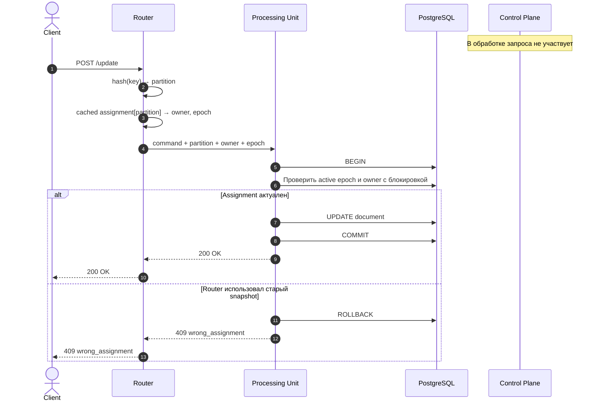
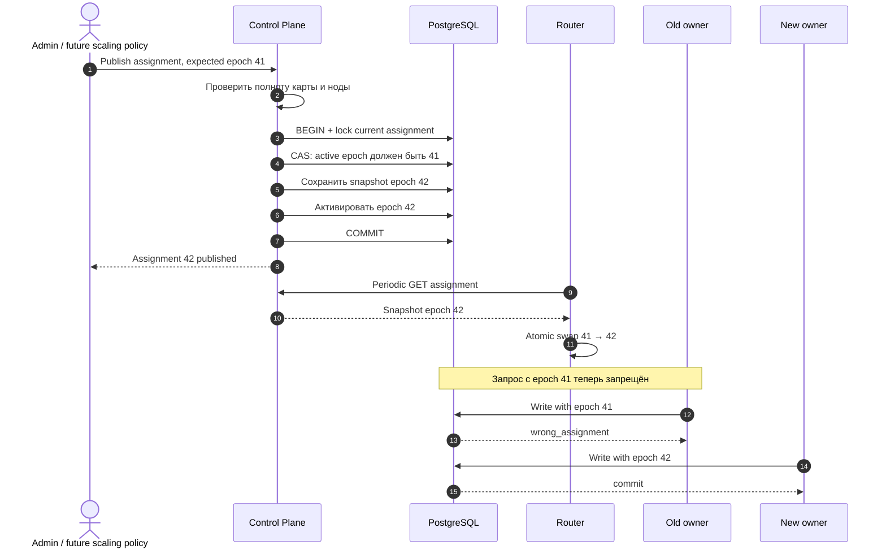

# Эпик 3: управляемый assignment и fencing

## Цель и границы

Эпик завершает A4 roadmap: Control Plane публикует неизменяемый snapshot `partition → processing unit` с монотонным epoch, Router применяет локальную копию snapshot, а PostgreSQL атомарно запрещает операции от устаревшего владельца.

Control Plane реализован на Scala 3: ZIO управляет эффектами и lifecycle, Tapir описывает HTTP endpoints поверх zio-http, zio-json кодирует строгие wire DTO, Doobie выполняет транзакции PostgreSQL. Сетевой контракт и роль компонента не изменились при переносе с Go.

Control Plane не входит в путь пользовательского CRUD-запроса. Физическая миграция строк, автоматическое изменение числа processing unit, Kubernetes, autoscaling и migration state machine остаются вне scope.

HTTP-контракт чтения и публикации snapshot: [Assignment API](api.md).

Текущий статус проверок: [валидация](validation.md). Состав поставки и точка продолжения: [changelog](changelog.md).

## Путь пользовательского запроса

Router по-прежнему вычисляет logical partition и выбирает HTTP-адресат, но больше не владеет конфигурацией assignment. Он получает полный snapshot и разрешает маршруты локально. Processing unit не обращается к Control Plane на каждый запрос: окончательный fencing выполняет PostgreSQL в той же транзакции, что и операция документа.

## Публикация нового assignment

При публикации Control Plane блокирует строку активного состояния через `FOR UPDATE`. Операция документа берёт `FOR SHARE` на ту же строку и удерживает блокировку до commit. Поэтому старая операция либо коммитится до активации нового epoch, либо после активации получает `wrong_assignment`; commit устаревшего владельца после публикации невозможен.

## Ответственность компонентов

| Этап | Control Plane | Router | Processing unit | PostgreSQL |
|---|---|---|---|---|
| Валидация и публикация карты | выполняет | — | — | хранит атомарно |
| Получение snapshot | отдаёт | кэширует | — | источник истины |
| Вычисление partition | — | выполняет | — | — |
| Выбор HTTP-адресата | — | выполняет | — | — |
| Проверка метаданных запроса | — | — | выполняет | — |
| Окончательный fencing | — | — | передаёт token | выполняет атомарно |
| Изменение документа | — | — | инициирует | выполняет |

## Инварианты

- epoch — положительное монотонное целое число;
- новый snapshot публикуется только при совпадении `expected_epoch`;
- snapshot содержит каждый раздел ровно один раз и ссылается только на известную ноду;
- `partition_count` не меняется обычной публикацией assignment;
- Router устанавливает только полностью проверенный snapshot;
- успешная запись подтверждается только после атомарных fencing, изменения документа и commit;
- временная рассинхронизация Router и Control Plane ухудшает доступность, но не допускает stale write.

## Критерии готовности

- Control Plane восстанавливает активный snapshot из PostgreSQL после перезапуска;
- Router получает начальный snapshot до readiness и обновляет его без рестарта;
- старый epoch получает `409 wrong_assignment` без изменения документа;
- гонка публикации и длительной записи имеет однозначный порядок commit;
- текущие CRUD/revision гарантии и отсутствие автоматических повторов записи сохраняются;
- unit, race и PostgreSQL integration tests покрывают публикацию, CAS и fencing.
