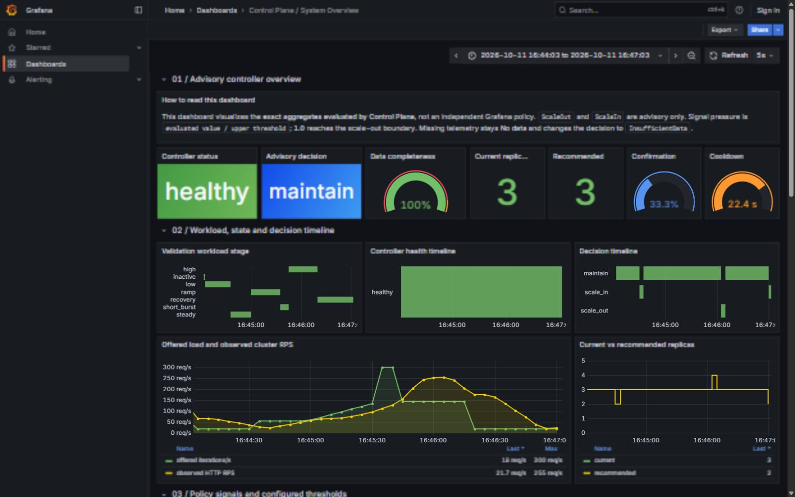
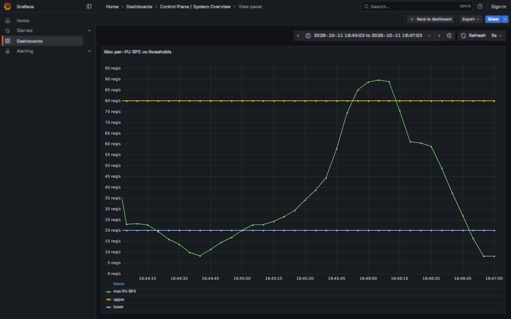
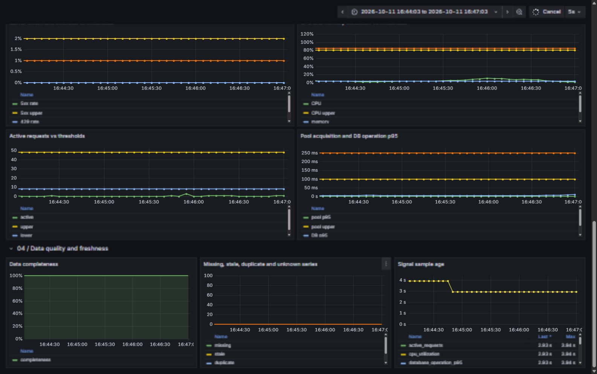

# Эпик 4: validation report

## Результат

Приёмка выполнена 11.10.2026 и расширена 12.10.2026 в ветке `epic/4-observable-control-plane`. Control Plane построил полный `SystemState` по трём processing unit, оставался доступным при неполной телеметрии, публиковал только advisory-решения и не менял replicas или assignment. Статические, unit, race, PostgreSQL integration и public CRUD проверки прошли. Отдельными контейнерными сценариями подтверждены все девять policy-trigger, включая CPU, memory, latency, pool, DB execution, active requests, `429` и `5xx`, а не только RPS. Compose-стек оставлен запущенным.

## Среда и параметры

- Docker Engine `29.8.2`, 12 CPU, 8.17 GB memory;
- три processing unit, assignment epoch `2` во время нагрузочной проверки;
- polling `5s`, observation window `30s`, sample max age `15s`;
- confirmation `3` последовательных окна, cooldown `30s`;
- RPS thresholds: lower `20`, upper `80` на наиболее загруженный processing unit;
- controller workload: base rate `120`, duration `180s`, neutral warm-up `35s`, `80%` read, `4096` records, payload `1024` bytes;
- Grafana показывает время `Europe/Moscow`; сохранённые Prometheus timestamps имеют UTC.

Нейтральный warm-up использует steady-интенсивность `45%` от base rate. Он вытесняет seed traffic из 30-секундного окна и не создаёт ложное решение до измерения. Это поведение покрыто unit-тестом.

## Выполненные проверки

```powershell
make check
make integration
make smoke
docker compose --profile test run --build --rm control-plane-tests
./benchmarks/run.ps1 -Scenario constant -Rate 100 -Seconds 30 -WarmupSeconds 5
./benchmarks/run.ps1 -Scenario ramp -Rate 100 -Seconds 30 -WarmupSeconds 0
./benchmarks/run.ps1 -Scenario burst -Rate 100 -Seconds 30 -WarmupSeconds 0
./benchmarks/run.ps1 -Scenario controller -Rate 120 -Seconds 180 -WarmupSeconds 35
```

Результаты:

- Scala Control Plane: `32` теста, `0` failures, включая Prometheus response handling, missing/stale/duplicate/unknown series, epoch change, no-overlap polling, hysteresis, confirmation, cooldown, bounds, независимый scale-out по каждому policy-сигналу и PostgreSQL CAS;
- Processing Unit и Router container race/integration suites прошли;
- public CRUD smoke прошёл, включая conflicts и delete/recreate;
- `constant`: `3645/3645` success, `0` errors/drops, p95 `6.45ms`, p99 `9.19ms`;
- `ramp`: `2182/2182` success, `0` errors/drops, p95 `6.64ms`, p99 `8.54ms`;
- `burst`: `5102/5102` success, `0` errors/drops, p95 `6.34ms`, p99 `9.47ms`;
- приёмочный `controller`: `17506/17506` success, `0` conflicts/errors/drops, p50 `2.75ms`, p95 `4.96ms`, p99 `7.88ms`.

Архив приёмочного workload находится в ignored-каталоге `results/20261011T134302.411560115Z`. Он содержит effective config, environment, request log, summary и Prometheus snapshot. Dashboard URL зафиксирован в этом же каталоге.

## Сводный dashboard



Верхний ряд — текущий срез на конце выбранного интервала: controller `healthy`, completeness `100%`, current replicas `3`. Overview использует instant queries, поэтому `Advisory decision` показывает одно текущее значение; вся история остаётся в timeline ниже. `Recommended`, confirmation и cooldown отражают состояние policy, но не являются actuator state.

Timeline подтверждает причинную связь:

| Интервал Grafana (MSK) | Фаза | Наблюдение и решение |
|---|---|---|
| `16:44:03–16:44:33` | `low` | Нагрузка падает после neutral warm-up. Max per-PU RPS проходит ниже lower `20`; после трёх окон в `16:44:28` появляется краткое advisory `ScaleIn`, recommendation `3 → 2`. Фактические replicas остаются `3`. |
| `16:44:38–16:44:58` | `steady` | RPS возвращается в hysteresis band, policy публикует `Maintain`. Никакого обратного решения на первом изменении сигнала нет. |
| `16:45:03–16:45:33` | `ramp` | Offered load и observed HTTP RPS растут; max per-PU RPS ещё ниже upper `80`, поэтому сохраняется `Maintain`. |
| `16:45:38–16:45:43` | `short_burst` | Offered rate кратко достигает `300 iterations/s`. Из-за 30-секундного окна агрегат растёт плавно; единичный burst не даёт немедленного actionable decision. |
| `16:45:48–16:46:18` | `high` | Sustained load удерживает max per-PU RPS выше `80`. Confirmation проходит `1/3 → 2/3 → 3/3`, и в `16:46:03` появляется advisory `ScaleOut`, recommendation `3 → 4`. |
| `16:46:23–16:47:03` | `recovery` | Offered load падает до `18 iterations/s`, но 30-секундное окно удерживает observed RPS выше мгновенной нагрузки. После спада всех обязательных сигналов ниже lower thresholds и завершения cooldown в `16:46:58` публикуется новый `ScaleIn`, recommendation `3 → 2`. |

Controller health был `healthy` во всех `37` сохранённых пятисекундных срезах. Completeness оставалась `100%`; missing, stale, duplicate и unknown-node counts были равны нулю.

## RPS относительно thresholds



Это основной trigger прогона. Зелёная линия — тот же агрегат, который оценивает policy; голубая и жёлтая линии — lower `20` и upper `80`. Минимум составил `8.08 req/s`, максимум — `89.64 req/s`.

- Первый проход ниже lower соответствует low-фазе и подтверждённому `ScaleIn`.
- Рост через lower во время steady/ramp возвращает policy в hysteresis band.
- Пересечение upper начинается около `16:45:50`; решение не появляется в точке пересечения, потому что требуются три последовательных controller window.
- Пик приходится на sustained high, а не на один scrape short burst: 30-секундное окно намеренно сглаживает краткую ступень.
- В recovery линия убывает с задержкой окна; `ScaleIn` разрешается только после устойчивого ухода ниже lower и cooldown.

## Остальные сигналы и качество данных



Ни один дополнительный safety signal не пересёк upper threshold:

| Сигнал | Максимум | Upper threshold |
|---|---:|---:|
| HTTP p99 | `23.09ms` | `200ms` |
| active requests | `3` | `48` |
| pool acquisition p95 | `0.952ms` | `100ms` |
| DB operation p95 | `9.91ms` | `250ms` |
| CPU utilization | `10.76%` | `80%` |
| memory utilization | `4.04%` | `85%` |
| server error rate | `0%` | `2%` |
| overload (`429`) rate | `0%` | `1%` |

Поэтому `ScaleOut` объясняется RPS, а не latency, resource saturation или ошибками. Это ожидаемая работа multi-metric policy: верхний threshold любого обязательного сигнала может инициировать scale-out, но Grafana позволяет увидеть, какой именно сигнал был причиной.

Нижний ряд скриншота показывает completeness `100%`, нулевые missing/stale/duplicate/unknown counts и sample age около `3–4s`, то есть меньше `max_sample_age=15s`. При пустых histogram series до первого трафика Control Plane отдельно проверен в состоянии `degraded/InsufficientData`; assignment API и readiness при этом оставались доступны. После появления series состояние автоматически стало `healthy` без рестарта.

## Расширенная проверка всех scale-out triggers

Повторная проверка 12.10.2026 устраняет ограничение первого controller workload: в нём threshold пересекал только RPS. Для каждого класса сигналов использован отдельный контейнерный источник давления, а причинность проверена по controller-published `storage_control_signal_value`, `storage_control_signal_pressure_ratio` и `storage_control_decision`. Pressure ratio равен `signal / upper threshold`; значение больше единицы означает реальное пересечение настроенного upper threshold.

Перед сценариями добавлен табличный unit-тест `treats every configured policy signal as an independent scale-out trigger`. Для каждого элемента `SignalName.policySignals` он оставляет остальные значения в hysteresis band, проводит два требуемых confirmation window и проверяет `ScaleOut` с причиной именно этого сигнала. Тест исключает ситуацию, когда метрика отображается, но забыта в policy.

### CPU container pressure

```powershell
./benchmarks/run.ps1 -Scenario constant -Rate 20 -Seconds 60 -WarmupSeconds 10 -Records 128
```

Во время измеряемого окна внутри cgroup `processing-unit-1` выполнялся ограниченный по времени busy loop. Архив: `results/20261011T221123.771357833Z`.

| Сигнал | Максимум pressure ratio |
|---|---:|
| CPU utilization | `1.251` |
| HTTP p99 | `0.466` |
| DB operation p95 | `0.165` |
| RPS | `0.142` |
| memory utilization | `0.089` |

Фактический CPU utilization достиг `1.001` при upper `0.8`; `storage_control_decision{decision="scale_out"}` стал равен `1`. Все остальные сигналы оставались ниже своих upper thresholds, поэтому это независимое end-to-end доказательство CPU-trigger. Workload завершил `1451/1451` запросов без errors/drops.

### Memory container pressure

```powershell
./benchmarks/run.ps1 -Scenario constant -Rate 10 -Seconds 60 -WarmupSeconds 10 -Records 128
```

Для `processing-unit-1` временно установлен cgroup limit `80 MiB`, после чего `62 MiB` удерживались в `/dev/shm` только в течение измеряемого окна. `docker stats` зафиксировал `70.18 MiB / 80 MiB`. После теста файл удалён, а limit восстановлен до `201326592` bytes (`192 MiB`). Архив: `results/20261011T221345.374816606Z`.

| Сигнал | Максимум pressure ratio |
|---|---:|
| memory utilization | `1.028` |
| RPS | `0.116` |
| HTTP p99 | `0.104` |
| CPU utilization | `0.047` |
| DB operation p95 | `0.038` |

`storage_control_decision{decision="scale_out"}` стал равен `1`; ни один другой trigger threshold не был пересечён. Workload завершил `737/737` запросов без errors/drops.

### PostgreSQL lock, concurrency, overload and errors

```powershell
./benchmarks/run.ps1 -Scenario db-lock -Rate 300 -Seconds 60 -WarmupSeconds 5 -Records 128
```

Сценарий удерживал `LOCK TABLE documents IN SHARE MODE` в отдельной PostgreSQL session `20s`. Одновременно отдельный load-контейнер создавал высокую конкуренцию через Router. Архив: `results/20261011T221539.785216677Z`.

| Policy signal | Наблюдавшийся максимум | Upper | Pressure ratio |
|---|---:|---:|---:|
| pool acquisition p95 | `4.430s` | `0.100s` | `44.303` |
| HTTP p99 | `4.902s` | `0.200s` | `24.508` |
| DB operation p95 | `1.393s` | `0.250s` | `5.572` |
| server error rate (`5xx`) | `7.379%` | `2%` | `3.689` |
| overload rate (`429`) | `2.799%` | `1%` | `2.799` |
| RPS | `128.695` | `80` | `1.609` |
| active requests | `64` | `48` | `1.333` |
| CPU utilization | `20.926%` | `80%` | `0.262` |
| memory utilization | `7.542%` | `85%` | `0.089` |

Контроллер опубликовал `ScaleOut`. Клиент зафиксировал `15807` success, `292` errors, `4578` dropped iterations, p95 `2.087s`, p99 `2.837s`. CPU и memory не пересекали thresholds, поэтому SQL/concurrency причины отделены от двух ресурсных сценариев. Этот прогон намеренно диагностический: число ошибок ожидаемо из-за lock, statement/request timeouts и admission saturation.

### Недоступный Prometheus

Отдельный одноразовый контейнер `autoscale-control-plane-unavailable-test` был подключён к PostgreSQL и получил локальное host override `prometheus → 127.0.0.1`, поэтому его MetricsSource был недоступен, а основной Control Plane продолжал работать. Результат после polling/retry:

```text
GET /readyz            -> 200
control state status   -> degraded
metrics source status  -> unavailable
decision               -> insufficient_data
blocked_by             -> metrics_source_unavailable, missing_signals
```

После проверки одноразовый контейнер удалён. Это подтверждает failure isolation на реальном runtime: недоступность Prometheus не делает Control Plane unready и не влияет на assignment API.

### Финальный regression gate

12.10.2026 повторно выполнены:

```powershell
make check
make integration
make smoke
```

`make check` прошёл для всех Go-модулей и Scala Control Plane. `make integration` отдельно собрал и выполнил processing-unit race/PostgreSQL suite, Router race suite и Scala/PostgreSQL suite (`32/32`). Public CRUD smoke завершился сообщением `PASS: Router CRUD, conflicts, delete/recreate and optional database recovery`.

## Ограничения результата

- thresholds являются диагностической конфигурацией этого локального стенда, а не production SLO;
- recommendation не изменяет replicas, поэтому `current=3` на всём интервале — обязательный результат, а не недореализованный actuator;
- тест подтверждает наблюдение и decision semantics, но не topology discovery, Kubernetes scaling, assignment reconciliation или безопасный draining;
- результаты не являются сравнительным benchmark; для него нужны отдельная калибровка ресурсов, повторения и статистический отчёт.
